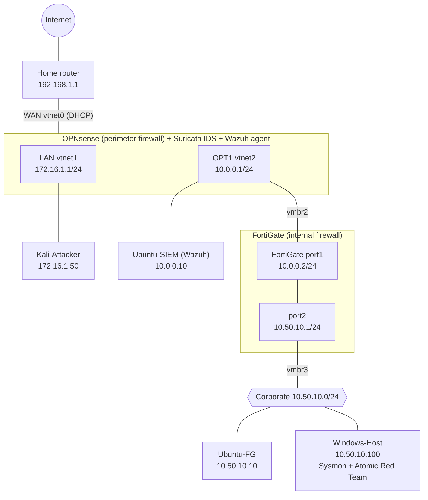

# SecOPS Lab

A segmented, multi-firewall home lab for practising security monitoring and detection engineering. Traffic crosses two firewalls (OPNsense and FortiGate), an IDS watches the perimeter, and a Wazuh SIEM collects telemetry from every endpoint. A Kali machine attacks the lab and Atomic Red Team simulates attacker behaviour so each detection can be tested.

Everything runs as virtual machines on a single Proxmox host.

## Topology



## Zones

| Zone | Subnet | Sits behind | Hosts |
|------|--------|-------------|-------|
| Public / WAN | DHCP from home router (192.168.1.1) | OPNsense `vtnet0` | none |
| Attacker | 172.16.1.0/24 | OPNsense LAN `vtnet1` | Kali-Attacker |
| Internal / transit (DMZ) | 10.0.0.0/24 | OPNsense OPT1 `vtnet2` | Ubuntu-SIEM, FortiGate `port1` |
| Corporate | 10.50.10.0/24 | FortiGate `port2` | Ubuntu-FG, Windows-Host |

## Components

| Component | Role | Version |
|-----------|------|---------|
| Proxmox VE | Hypervisor that hosts every VM | n/a |
| OPNsense | Perimeter firewall, NAT, routing | 26.1.11_10 (FreeBSD 14.3) |
| FortiGate-VM | Internal firewall for the corporate zone | v7.6.7 build 3704 |
| Wazuh | SIEM: log collection and alerting | 4.14.6 (OPNsense agent 4.14.5) |
| Suricata | IDS on OPNsense (detects, does not block) | 8.0.6 |
| Sysmon + SwiftOnSecurity config | Windows endpoint telemetry | config v74 |
| Atomic Red Team | ATT&CK-mapped attack simulations | see [attack-simulation](docs/attack-simulation.md) |
| Kali Linux | Attacker machine | n/a |

## Documentation

- [Architecture](docs/architecture.md): how traffic flows between zones
- [IP addressing](docs/ip-addressing.md): interfaces, hosts, routes
- [Firewall rules](docs/firewall-rules.md): OPNsense rules and NAT, FortiGate policies
- [Monitoring stack](docs/monitoring.md): Wazuh, Suricata, Sysmon
- [Attack simulation](docs/attack-simulation.md): Atomic Red Team plan and detection results
- [Verification](docs/verification.md): checks that prove the lab works
- [Security notes](docs/security-notes.md): known limitations of this design

## Repository layout

```
docs/       write-ups and diagrams
configs/    firewall, Wazuh and Sysmon configs (see configs/README.md and SANITIZATION.md)
diagrams/   diagram sources
```

## Credentials

No credentials are stored in this repository. Lab logins live in a private password manager.

## Credits

The Sysmon configuration is the community template by [SwiftOnSecurity](https://github.com/SwiftOnSecurity/sysmon-config), licensed CC BY 4.0.
